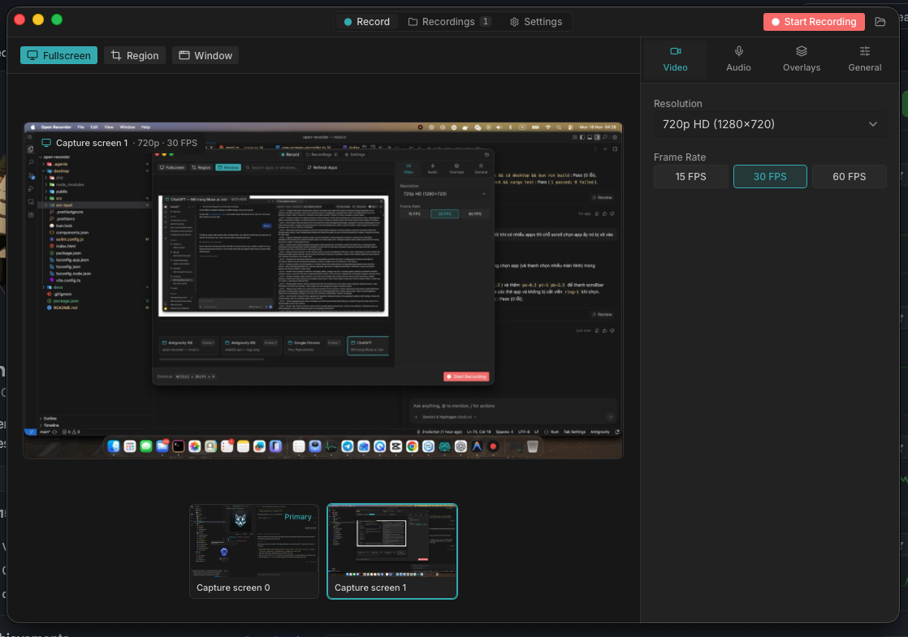

# Open Recorder

A lightweight, capture-first desktop screen recorder for macOS, Windows, and Linux.



## Features

- **Screen, Region & App Window Capture**: Record fullscreen, a custom `Region` (drag directly on preview or use the fullscreen selector), or an open application `Window` (with search and automatic multi-monitor detection), with live display preview, configurable resolution (`720p`, `1080p`, `4K`, `original`), FPS (`15`, `30`, `60`), and pause/resume.
- **Settings & Diagnostics Screen**: Inspect FFmpeg status, storage and library paths, OS privacy shortcuts, and default capture settings.
- **Microphone & Audio Monitoring**: Select audio input devices with a real-time microphone VU meter.
- **Mouse & Keystroke Overlays**: System-wide mouse click highlights, keystroke display, optional camera PiP, and live screen annotations.
- **Recordings Library & Export**: Automatic thumbnail generation, fast video trimming, and GIF export saved directly to disk.
- **System Tray**: Quick access to open the main window or quit from the system tray.

## Project Structure

```text
open-recorder/
├── .agents/
│   └── AGENTS.md             # Architecture and development guidelines
├── README.md
└── desktop/
    ├── package.json          # Frontend & Tauri CLI scripts
    ├── vite.config.ts
    ├── src/                  # React 19 + Tailwind v4 + shadcn/ui frontend
    │   ├── components/
    │   ├── hooks/
    │   └── lib/
    └── src-tauri/            # Rust backend (Tauri v2)
        ├── Cargo.toml
        ├── tauri.conf.json
        ├── capabilities/
        └── src/
            ├── capture/      # Screen & audio capture + Mic VU meter (cpal)
            ├── commands/     # #[tauri::command] handlers for the UI
            ├── db/           # SQLite repository (diesel + libsqlite3-sys bundled)
            ├── input_hooks/  # Global mouse & keyboard listener (rdev)
            └── processor/    # FFmpeg thumbnail, trim, and GIF export
```

## Development

**Prerequisites:** [Rust](https://rustup.rs/), [Bun](https://bun.sh/) (`>= 1.2`), and `ffmpeg` / `ffprobe` in `PATH`.

```bash
bun install --cwd desktop
bun dev          # Run desktop app in development
bun run build    # Build production bundle
```

- **Checks:** `bun run --cwd desktop typecheck && bun run --cwd desktop lint` and `cargo test` in `desktop/src-tauri/`.
- **macOS Permissions:** Grant **Screen Recording**, **Microphone**, and **Accessibility** in **System Settings → Privacy & Security** (`OpenRecorder` / your terminal in dev mode, or **Open Recorder** in production).
